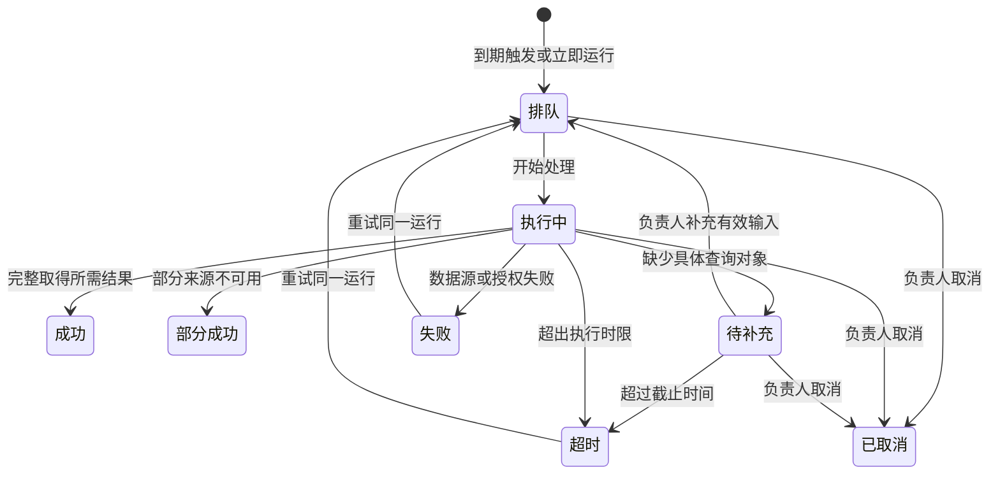

# teleConnect 143 TMD：142 之后全部更新

版本：143，任务通知与审计交互修订版  
日期：2026-10-29  
基线：`teleConnect_AI主动模式原型_142.html`  
交付原型：`teleConnect_AI主动模式原型_143.html`

本文是累计技术设计说明，覆盖 143 初次补充的 P0/P1、恢复 142 界面与内容的修订，以及本次任务通知、任务菜单、私聊提及和后台审计调整。以当前 143 的最终行为为准，不能用早期 143 的简化页面替代最终界面。142 文件未修改。

“原型已实现”指本地 HTML 可操作的交互与状态；“生产需接入”指开发约定，不代表真实服务已完成。AI、业务接口、定时调度、跨用户投递及系统通知均未与生产系统联通。本文不承诺 HTML 关闭后仍能执行任务。

## 交付范围与保留原则

| 分类 | 当前范围 |
| --- | --- |
| 已有能力复用 | teleConnect+ 客户端布局、Chat/Cowork、原有五个 AI 会话、我的业务、主动服务、知识案例、聊天历史、模型入口、文件问答、悬浮多窗口、看板入口、后台完整导航及原有表格和编辑器 |
| P0 补充 | 机器人与访问控制衔接、内嵌页面异常恢复、模板/订阅/运行分离、配置版本快照、调度去重、来源与结果状态、草稿确认及执行边界 |
| P1 补充 | 补充信息后续跑、AI 助手聚合、文件解析状态与引用、受控分享、任务通知与未读计数、立即运行、Q&A 审计关联 |
| 本轮明确调整 | 后台删除客户端续聊行为；私聊只 @ 我的AI；独立主动服务入口；运行/完成提醒及系统效果说明；任务操作菜单 |
| P2 暂不扩展 | 通用对象图谱、周期性全量资源抓取维护、复杂业务编排、自主闭环执行等。142 中已有相关页面和功能入口保留，本轮不新增其逻辑 |

客户端保留原有会话与消息内容，包括五个 AI 会话、AI 助手原有六条示例提醒、原来的业务与案例入口。主动服务沿用 142 的模板、我的业务、搜索、分页、详情和表单。后台沿用 MESH 风格、分组菜单、模板和实例表格；原有七条订阅保留。新增内容进入原有页面，不用简陋独立列表替换整套功能。

## 累计变更总表

| 页面/功能 | 142 之后的最终变化 | 验收重点 |
| --- | --- | --- |
| 机器人配置与我的AI | 配置机器人映射到可用 AI；启停、访问名单与用户身份参与入口和调用校验；保留原五个会话 | 被停用或拒绝访问的机器人不能继续调用；切换身份不继承他人私有数据 |
| OSS/Big Data 内嵌页 | 正常、加载中、失败、登录失效状态及恢复入口；保留原 Chat/Cowork、历史、看板操作 | 加载失败不能表现为空白成功；刷新恢复不混入其他 AI 的内容 |
| 主动服务表单 | 查询范围、统计区间、通知策略、配置版本；原周期、时区、生效区间等继续可用 | 保存仅改变后续运行；历史运行仍读旧快照 |
| 调度与运行 | 唯一运行标识、重复触发去重、同任务未结束运行保护、暂停/恢复、立即运行 | 多次点击不创建并发重复任务；手动执行不修改定时计划 |
| 结果和来源 | 成功、部分成功、无数据、失败、超时、待补充、取消；来源标识和取得时间 | 查询失败不解释为业务正常；摘要成功不等于工单或故障已关闭 |
| 信息补充 | 明确负责人、具体输入、截止时间；继续同一 Run ID | 输入留在本次运行，不能自动成为资源主数据 |
| AI 助手 | 原提醒加上新运行提醒，按身份展示，结果关联运行 | 不删除原消息；未读与业务状态分开 |
| AI 草稿 | 私有生成、编辑问题/答案、重新生成、发送校验、失败保留、避免重复发送 | 确认前不发到会话；更改问题后的过期答案不能直接确认 |
| 文件问答 | 文件编号/版本/解析状态、正文来源、权限复核；修复文件 AI 列表遮挡 | 不可提问的文件不得被当作已读正文；列表不越界裁切 |
| 分享 | 固定快照、明确接收者、有效期、撤销、只读答案或独立续聊 | 分享不转移附件权限，不修改发送者会话，不自动创建订阅 |
| 后台审计 | 查看 Q&A Log 替代“在会话中继续”；新增运行到审计记录关联 | 后台始终留在后台，只读，不消耗客户端未读状态 |
| 私聊 @ | 单列“我的AI”，去掉全部和成员；群聊维持原逻辑 | 私聊键盘/鼠标均只能选 AI；群聊仍能选成员 |
| 聊天顶部 | 主动服务图标与文字独立放在 Chat/Cowork/返回对话旁，带红标 | 保留会话菜单；打开列表不清零，查看具体完成结果才减少 |
| AI 小气泡 | 排队/执行动效、完成勾选、任务名提示、需处理状态、结果入口 | 成功与失败清晰区分；关闭提示不等于已读 |
| 任务菜单 | 暂停/恢复、立即运行、编辑、分享、删除 | 每项都进入实际交互；删除前说明历史保留规则 |
| 本机保存 | 143 独立数据、压缩重复头像、localStorage/IndexedDB 回退、导出备份 | 保存异常不一概误报空间不足；不覆盖 142 数据 |

## 客户端：主动服务入口和结果查看

位置：AI 会话顶部右侧，在 Chat/Cowork 或“返回对话”按钮旁增加时钟图标与“主动服务”。保留右侧会话菜单、我的业务与知识案例入口。

点击后进入原 142 风格的主动服务页。有未读完成结果时定位“已完成”，否则进入默认服务视图。原模板、我的业务、已启用筛选继续存在。原先将“启用的计划”写成“运行中”的标签改为“已启用”，避免把定时计划状态与一次运行状态混淆。

“已完成”展示成功和部分成功的运行。搜索任务名称或编号；列表分页；查看运行可看来源、时间线与固定配置。未读时页签数字强调未读量，全部已读后显示完成总量，页脚明确总量和未读量。标题处红标仅表示未读完成结果。

红标计算规则：当前用户拥有、当前 AI 范围内、状态为成功或部分成功、尚未查看的运行数。右下角 AI 气泡汇总当前用户所有 AI 的完成未读数。大于 99 显示 `99+`。失败、超时、取消、待补充不计入“已完成”红标，但仍保留提醒与运行记录。

打开服务列表、切换页签、关闭浮层不减少未读。点击具体结果，或客户端进入该运行会话后，该运行标为已读并同步 AI 助手提醒。后台读审计不改变用户已读。运行中提前查看，不代表未来完成结果已读。

## 客户端：任务操作菜单

每条任务右上角增加“⋯”，使用与现有界面一致的圆角、间距与颜色；“立即运行”也保留为明显的行内按钮。后台实例行同样增加操作入口，但不会跳到客户端。

| 动作 | 触发与处理 | 结果及异常 |
| --- | --- | --- |
| 暂停 | 启用任务 → 菜单暂停 | 停止未来定时触发；已开始的运行继续。暂停不等于取消运行 |
| 恢复计划 | 已暂停任务 → 恢复计划 | 重新计算未来计划；不补跑暂停期间所有周期 |
| 立即运行 | 启用任务 → 校验身份、AI 和配置 → 创建一次手动运行 | 保持周期与下一计划不变；已有排队/执行/待补充运行时打开原运行，不再创建 |
| 暂停时立即运行 | 已暂停任务 → “立即运行一次”确认框 | 确认后只跑一次，任务仍暂停；取消则不创建运行 |
| 编辑 | 打开原 142 编辑表单，修改名称、指令、计划、范围或通知方式 | 保存生成新配置版本；旧运行快照不变；未保存离开有提示 |
| 分享 | 生成任务配置的只读内容快照；选择接收者和有效期 | 不自动创建对方订阅，不转移负责人或执行/文件权限；可撤销 |
| 删除 | 显示名称与后果，二次确认 | 停止未来计划，任务退出列表；历史运行、Q&A Log、已发结果保留。进行中的运行继续，需停止时另行取消 |

草稿未完成配置时不得运行。机器人停用或访问资格变化时重新校验，显示明确原因。运行中的编辑只影响下一次运行。生产端应使用配置版本进行并发更新检查；出现版本冲突时提示重新加载，而非覆盖他人修改。

原型没有向外部系统发送分享或删除生产任务；当前菜单处理的是本地演示数据。

## 一次运行的完整状态流程



| 状态 | 需要显示 | 可操作项 |
| --- | --- | --- |
| 排队 | 任务名称、正在准备、本次 Run ID、旋转动效 | 查看详情、取消当前运行 |
| 执行中 | 正在读取授权数据/整理结果与来源；无虚假百分比 | 查看详情、取消当前运行 |
| 待补充 | 缺什么、谁补充、截止时间、输入框 | 输入并继续同一次运行、取消 |
| 成功 | 完成勾选、名称、摘要、来源、取得时间 | 查看结果、客户端继续提问、后台只读审计 |
| 部分成功 | 部分完成提示、成功来源及缺失来源、结论范围 | 查看结果；不能包装成完整成功 |
| 失败/超时 | 原因、未取得结果的说明、时间线 | 重试原运行；不增加完成红标 |
| 已取消 | 取消记录、未来计划未改变的说明 | 查看历史；迟到回调不得改为成功 |

本地运行按约 0.65 秒开始读取、2.3 秒整理、4.4 秒产生结果演示。真实系统必须按后端事件推进，不能照搬这些时间作为业务耗时。

重试保留 Run ID、配置快照、原失败记录，尝试次数增加；原型最多 3 次尝试。信息补充使用原 Run ID，输入 2–200 字的具体对象，演示截止时间为 24 小时。补充不会修改订阅，更不会维护全量资产台账或自动写入图谱。生产需按领域定义更精确的输入结构和超时策略。

无数据是“查询成功但本范围内无数据”；访问拒绝是失败；部分来源失败是部分成功。不得互相替代。成功只表示本次 AI 摘要完成，不表示修复设备、关闭工单、发送邮件或分配行动项。

## 客户端：右下角 AI 气泡与完成通知

任务开始后，气泡外缘显示旋转动效，旁边展示任务名和当前阶段；点击可打开对应运行。任务成功后显示勾选完成标记及“XXX任务已完成”；部分成功显示“任务部分完成”；失败、超时、待补充使用需处理提示。气泡本身原有 AI 菜单与窗口入口保留。

提示提供“查看结果”“关闭任务提示”“通知效果说明”。关闭仅隐藏当前提示；结果和红标继续保留。查看结果标记该运行已读。多条提醒在同一面板内显示，最多展示三条；更多内容从“查看全部”进入运行列表，避免不断堆叠覆盖主工作区。

任务结果、提示展示和已读是三种独立状态。事件去重以运行、尝试次数、状态为依据；同一完成事件不会重复累加未读。重新加载页面保留结果和未读，但不重新弹出已存提示。页面关闭时尚在本地执行的任务恢复后标为中断失败，允许手动重试，不偷偷重放请求。

通知策略沿用任务配置：每次结果、结果变化时、仅异常或待处理。策略控制是否产生主动提醒；完成历史与完成未读计数仍可查看。系统勿扰、通知拒绝不应丢失应用内结果。

## Mac 与 Windows：原型可演示什么、客户端必须实现什么

入口紧邻气泡：“通知效果说明”；也可从“143 · 演示设置”进入。可以选择平台、前台/后台模拟、通知允许/拒绝/勿扰、隐藏或显示任务名称，以及下一次立即运行的成功/部分成功/待补充/失败/超时结果。

HTML 已实现页面内的 macOS 通知卡片、Windows 通知与任务栏闪烁示意、点击模拟通知打开对应结果。**它不会调用系统通知权限，也不会改变真实 Dock 或 Windows 任务栏。** 不应把截图中的页面示意当作操作系统已收到消息。

| 场景 | macOS 正式效果 | Windows 正式效果 | 原型表达 |
| --- | --- | --- | --- |
| 运行中 | 客户端内气泡阶段与加载动画 | 客户端内动画；任务栏可显示不确定进度 | 已实现应用内阶段与动效 |
| 前台完成 | 显示任务完成提示；是否同时系统横幅按客户端通知偏好 | 显示应用内完成提示，避免主动抢焦点 | 已实现气泡和红标 |
| 后台/最小化完成 | 请求系统横幅/通知中心送达；可同步 Dock 未读徽标 | 系统 Toast，任务栏请求闪烁；不把应用强行置前 | 可选页面内两种平台示意 |
| 点击通知 | 激活 teleConnect+，校验登录/任务权限，定位 Run ID 结果 | 激活客户端并定位结果，停止提示性闪烁 | “模拟点击系统通知”打开同一结果 |
| 拒绝通知 | 不反复请求，应用内保留未读；可提供系统设置指引 | 应用内保留未读；系统横幅不可保证 | 显示拒绝原因，不提供虚假的通知点击按钮 |
| 勿扰/专注模式 | OS 可能静默处理；不承诺横幅即时出现 | OS/用户设置可能抑制 Toast 或闪烁 | 显示说明，结果仍可查看 |
| 客户端完全退出 | 任务由服务端继续执行；通知取决于批准的推送或后台运行架构 | 同左，不能靠已关闭的网页执行 | 明确标注不支持后台真实执行 |
| 账号退出或访问撤销 | 先登录/校验，再决定是否能打开；不可泄露结果 | 同左 | 开发要求；未进行真实 OS 联调 |
| 多条同时完成 | 合并通知并指向未读列表，保持单条运行索引 | 合并 Toast/计数，避免无限闪烁 | 面板限制三条并提供全部入口 |

原生适配必须记录通知投递与交互回执，任务成功不能因系统通知被拒绝而改成失败。激活应用后停止提示性闪烁，但只有查看具体结果才减少该条未读。点击 OS 通知只打开结果，不能自动运行、重试、发送消息或执行设备操作。

通知默认支持隐藏任务名和业务正文。锁屏场景需遵从用户隐私设置；即使展示任务名，也不直接在系统通知里暴露告警详情、财务数值、附件正文和凭证。通知载荷只携带必要标识及展示信息，不携带访问令牌。

生产联调需由实际客户端技术栈选择原生通知、窗口激活、Dock/任务栏适配方式。本文定义可观察效果，不预设客户端采用 Electron、Qt 或其他框架，也不声称操作系统一定允许闪烁。

## 后台：运行记录与 Audit Center → Q&A Log

本次只读核对了实际后台的 `Audit Center → Q&A Log` 页面结构。新原型复用其审计语义及主要列，不复制真实用户日志数据。

实际界面参考路径：`/connect-admin-ai/auditCenter/record`，检查日期为 2026-10-29。原型的 `LOCAL-TRACE-…` 是演示标识，不是生产 Trace Id。

后台运行记录、运行详情里的“在会话中继续”全部改为“查看 Q&A Log”。点击后留在后台，按 Run ID 关联到只读审计详情；不切换客户端，不唤起桌面程序，不生成新提问，也不代用户补充、重试或取消运行。

审计列表字段：Session Name、Q&A Type、Agent Type、Chat mode、Operator Name、Operator Phone、Session Start Time、Session End Time、Trace Id / Run ID、Action。没有取得的电话显示“—”，不伪造。支持会话名称/Run ID/Trace Id 搜索、状态筛选、Search 和 Reset。

详情展示：任务请求、固定配置版本、原查询范围与统计区间、负责人补充记录、结果、关联追问及 AI 答复、来源标识与执行时间线。尚未发生的问答不生成占位假记录。页面明确“只读审计”，不提供输入框或客户端跳转。

后台查看审计不能把任务负责人客户端里的完成消息标记已读。列表与详情的访问资格在生产必须由服务端检查组织、角色和数据范围，前端切换页面不能代表真实授权。跨端深链接只属于客户端通知打开结果流程，不属于管理后台运行操作。

## 对话、AI 草稿与文件

### 私聊与群聊 @

私聊输入 `@` 后只显示“我的AI”单列；取消全部/成员标签与成员列表。支持上下键、Enter 选择、Esc 关闭；输入名称过滤；不可用 AI 依据机器人状态与用户访问规则过滤。保留本次 Chat/Cowork 模式选择。没有可用 AI 时显示原因提示。

群聊继续保留全部、成员、我的AI及原成员名单；不能为了修复私聊而删除群成员提及。AI 会话自身的提及同样以可用 AI 为候选，不引入联系人。

### 私有草稿与确认发送

@AI 或文件问答产生的私有草稿先展示问题和答案，仅当前用户可见。允许编辑问题、编辑答案、重新生成、取消及确认发送。修改问题后旧答案标记为过期，需要重新生成；不能把旧答案当作新问题的回答直接发送。

确认发送前复核机器人权限、文件权限与状态、会话上下文和草稿状态。确认只把内容发送到当前会话，不隐含设备执行、工单关闭或消息转发。发送失败保留草稿并提供重试；成功后防止重复确认。

用户切换时草稿、上传文件、模型偏好和上下文按身份隔离；不把同机器上的演示身份切换描述为生产身份认证。

### 文件 AI 选择与解析

修复“AI OSS agent Integration”附件旁 AI 按钮的列表：移到可见浮层，在视口内计算位置、宽度和最大高度，避免被消息容器裁切；选择 AI 后沿用原独立悬浮窗口问答流程。

新增 Chat Files/文件与解析状态入口。文件带 ID、版本、所有者、来源、解析状态和正文定位信息；状态为处理中、可提问、解析失败或无权限。失败与无权限时不能继续当作已解析文件调用；解析失败给出原因。

本地支持 DOCX、XLSX、PPTX、TXT、CSV 的有限正文提取；每次最多四个附件、单个不超过 50 MB。旧 DOC/XLS/PPT、PDF、扫描图片、受保护文件、复杂版式/OCR/公式计算需生产解析服务，原型不得伪装已完整识别。内置样例与142聊天附件明确标为演示内容。

引用包括文件版本与段落、单元格或幻灯片定位。运行固定其使用版本；后续文件变动不能悄悄改写旧结果证据。生产需要内容哈希、持久文件对象、解析任务与服务端权限，浏览器 `lastModified` 不能充当可靠的全局版本。

## 分享、上下文与内嵌页面

会话分享是固定消息快照，后续消息不自动加入；接收者独立续聊，不修改发送者历史。答案分享和任务配置分享仅阅读。创建时必须指定接收者和有效期（原型提供 1/7/30 天），所有者可以撤销；过期、撤销、无权、跨浏览器无本地记录时显示明确不可访问说明。

分享不转移附件、资源、机器人调用权限。接收者继续提问时重新检查原机器人是否可用。当前本地链接只在同一浏览器存储环境内验证，跨设备服务需开发。

上下文选择明确显示本次问题与附件等范围，限制将整个聊天或其他任务数据自动带入。模型与 AI 路由固定到本次请求，切换模型不追溯修改旧答案。

内嵌页面提供正常、加载、失败、登录失效演示及恢复操作。真实嵌入需宿主/子页面就绪、身份失效、请求开始/结束事件和允许来源校验；前端加载失败不能当成 AI 成功返回。原型保留现有 OSS/Big Data 入口和操作布局，不实现真实 SSO。

## 数据模型与关联

| 对象 | 必要信息 | 不变量 |
| --- | --- | --- |
| Bot | ID、AI Code、领域路由、状态、模型、访问策略 | 展示名称不是路由主键；停用后不能新调用 |
| Template | ID、版本、参数定义、默认任务指令 | 模板更新不自动改写已存在订阅 |
| Subscription | ID、负责人、组织、Bot、模板版本、指令、范围、区间、计划、时区、生效区间、通知策略、状态、配置版本 | 暂停/删除只影响未来；已执行快照不可变 |
| Run | Run ID、Subscription ID、触发方式/时刻、配置快照、尝试次数、输入、状态、时间线、来源、结果、Trace Id | 一次运行可补充或重试，保留身份与历史 |
| Source | 来源类型/标识、范围、统计期、获取时间、结果状态、文件版本/定位 | 缺失来源明确显示，不补造证据 |
| Notification | 事件 ID、Run ID、接收者、状态、生成时间、投递状态、已读时间 | 任务状态与已读独立；管理员审计不替用户确认 |
| Delivery | 同一运行+尝试+状态的展示键、平台/隐私策略、展示/关闭记录 | 去重不丢结果；关闭提示不改完成状态 |
| Draft | 所有者、会话/运行上下文、问题、答案、原版本、附件快照、发送状态 | 发送前私有，成功后不重复发送 |
| Share | 所有者、接收范围、快照、类型、有效期、撤销状态 | 不隐式授予其他资源权限 |

生产以服务端为事实来源。本地原型的 `R143`、localStorage、IndexedDB 仅为交互持久化，不是组织数据库，不应将客户端缓存内容作为授权依据。

### 调度与一致性

定时触发以订阅、配置版本、计划时刻构成幂等键；手动运行使用独立请求标识。一个订阅存在排队、执行中或待补充运行时，不再创建并发重复执行。生产应通过唯一索引和事务/分布式锁保证，而不只禁用按钮。

原型支持上海、亚的斯亚贝巴及 UTC 时区；生产使用标准 IANA 时区库、统一保存 UTC，并处理夏令时和时钟漂移。时间窗之外不再产生运行。演示调度恢复最多补最近一次到期，较早周期记为错过；暂停期间不补跑，不因恢复一次触发大量历史查询。

修改配置应带 expectedVersion；运行创建时复制版本、指令、AI 路由、模型、范围和通知策略。取消及完成竞态由后端终态校验处理：取消后不能被迟到成功事件覆盖。重试需重新校验实时权限，但不变更原配置快照。

### 建议接口与事件契约（待接入，非现有 API）

以下为开发拆分建议，不代表实际后台已有同名接口。

| 能力 | 请求关键字段 | 响应与要求 |
| --- | --- | --- |
| 保存订阅 | subscriptionId、expectedVersion、完整配置 | 新 version、状态、nextRunAt；冲突不静默覆盖 |
| 立即运行 | subscriptionId、requestId、单次执行确认 | runId、snapshotVersion、status；重复请求返回同一结果 |
| 暂停/恢复 | subscriptionId、expectedVersion、动作 | 新状态与下一次计划；不终止在途运行 |
| 补充/重试/取消 | runId、expectedState、requestId、输入 | 相同 runId、更新后的 attempt/status；校验负责人和状态 |
| 运行详情/审计 | runId 或 traceId、分页条件 | 受权限过滤的结果、来源、事件和关联问答 |
| 未读/已读 | 用户凭据、runId 或 notificationId | 幂等已读、各 AI/总未读；跨设备同步 |
| 通知投递 | eventId、runId、receiverId、状态、名称隐私策略 | 应用内持久消息、桌面投递状态；失败可补拉 |
| 分享 | snapshot、recipients、expiresAt、kind | shareId；访问时校验有效性与权限 |

建议完成事件示例：

```json
{
  "eventId": "unique-event-id",
  "type": "run.completed",
  "runId": "RUN-123",
  "subscriptionId": "SUB-123",
  "attempt": 1,
  "status": "success",
  "receiverId": "user-id",
  "botId": "oss",
  "snapshotVersion": 3,
  "occurredAt": "2026-10-29T09:00:00Z",
  "display": {"title": "任务已完成", "hideBusinessContent": true},
  "target": {"type": "run-result", "id": "RUN-123"}
}
```

客户端消费事件后先更新本地结果索引与红标，再按用户偏好决定系统展示；发送已接收回执。断线重连按游标补拉，使用 eventId 去重。打开结果再发送已读回执。不能只依赖 Toast：OS 投递失败、用户忽略通知或多设备登录时，服务端仍应保留可查询结果。

## 可直接照做的验收流程

### 成功运行与完成红标

1. 客户端进入 OSS agent，点顶部主动服务，进入“我的业务”。
2. 对“早间网络巡检”点立即运行；观察右下角任务名、排队/执行中动效。
3. 连续再点运行，只打开同一个 Run ID，不创建第二个任务。
4. 完成后出现“早间网络巡检任务已完成”、勾选与红标；原任务计划仍在。
5. 先关闭提示，红标不减少；重新进入已完成列表，红标仍保留。
6. 查看具体结果，红标减少一，结果/来源/配置快照仍可反复查看。

### 暂停、编辑、分享、删除

1. 在任务“⋯”菜单暂停，确认仍可查看历史运行。
2. 对暂停任务点立即运行，确认只运行一次；结束后状态仍为暂停。
3. 编辑原任务并保存，后续运行使用新配置版本；历史详情保持旧版本。
4. 分享任务配置，先预览内容再选择接收者/有效期；接收者不会自动获得执行权或新订阅。
5. 点删除，检查停止未来计划和保留历史的说明；取消则无变化，确认后任务移出列表，历史仍能从运行记录和审计查看。

### 待补充、失败和取消

1. 从通知效果说明选择“待补充”或从模拟试运行选择对应场景。
2. 运行进入待补充，输入有效对象后继续；Run ID 不变，时间线记录输入，输入不写回订阅。
3. 选择失败场景运行：出现需处理通知，不增加完成红标。
4. 将场景改回成功后重试原运行，检查仍为同一 Run ID、尝试次数增加、旧失败记录保留。
5. 在排队/执行时取消，等待原回调时间经过，状态仍为已取消；定时计划不因取消一次运行而暂停。

### 后台审计

1. 管理后台 → 主动服务运行记录，确认没有“在会话中继续”。
2. 点查看 Q&A Log，仍在后台；只读查看请求、结果、来源和时间线。
3. 返回列表，通过 Run ID 或 Trace Id 搜索，Reset 恢复列表。
4. 回客户端核对未读：后台查看未替用户标记已读。

### 私聊、群聊、原有功能保留

1. Girum 私聊输入 `@`，只能选择我的AI，没有全部和成员列。
2. OSS agent Integration 群聊输入 `@`，仍保留成员和AI。
3. 附件旁 AI 按钮打开列表，所有选项可见；选择 Big Data 后进入原悬浮文件问答。
4. 打开 AI 助手，原有提醒与新通知同时保留；会话菜单仍有我的业务、主动服务、知识案例。
5. 检查后台模板/实例原表格、原字段与分组导航，不以新增审计页替换其他模块。

### 系统通知效果与边界

1. 通知效果说明选择 macOS 或 Windows、后台/最小化、允许通知，执行一次任务。
2. 查看页面模拟通知；Windows 卡片显示任务栏闪烁示意，点击模拟通知进入对应结果。
3. 选择拒绝或勿扰，再运行；页面解释原因，应用内结果不丢失。
4. 生产验收必须在两种真实 OS 上分别测试权限首次申请、拒绝、勿扰、后台、最小化、退出/重启、锁屏隐私、点击激活与多账号权限。以上真实 OS 能力未由本 HTML 验证。

## 已执行检查与剩余联调边界

本次浏览器操作验证：运行阶段与完成气泡、Windows 示意、查看结果后红标减少、刷新保留未读且不重弹旧提示、私聊 AI 单列、群聊原成员列表、任务五项菜单、菜单打开完整编辑表单、暂停及恢复、暂停任务单次运行仍暂停、重复点击去重、分享配置弹窗、删除确认说明、后台运行到 Q&A Log 详情及列表/Reset、失败不增加完成红标及原运行重试。

上一轮 143 检查已覆盖：原五个 AI 会话/业务案例菜单、六条原提醒、原后台实例表、文件 AI 列表与浮窗、待补充后同运行成功、订阅 v1→v2 后旧运行仍为 v1、本机保存与刷新。自动规则检查覆盖权限优先级、时区/生效区间、运行幂等、不可变快照、失败/部分成功/无数据、分享授权/过期/撤销、通知去重、取消后迟到完成及所有内嵌脚本语法。

未作为已验证结果：真实 Mac/Windows 通知、服务端常驻调度、真实 SSO/组织权限、生产业务 API/AI 模型、跨设备分享、强制存储配额耗尽恢复、全格式文档解析。本轮未在浏览器确认删除原有示例任务，以保留完整展示数据；删除处理仍复用原142流程，新增保留运行历史的关联逻辑与说明。完成生产接入后需按上述验收流程逐项补测。

原型浏览器验证使用同一 HTML 的本机回环地址；最终仍交付独立 HTML。新版本保留142全部源码作为基线，构建时核对142 SHA-256：`d57f3b2a72f2a67edb0fa61177ea4679b0c78819b9df584c7561a853a16bc520`。

交互截图：

- [运行中动效](.prototype143/qa/revision3/running.png)
- [Windows 完成提示示意](.prototype143/qa/revision3/completed-windows.png)
- [私聊只显示我的AI](.prototype143/qa/revision3/private-at.png)
- [任务操作菜单](.prototype143/qa/revision3/task-menu.png)
- [后台只读 Q&A 详情](.prototype143/qa/revision3/audit-detail.png)

- [最终版 Mac 完成通知示意](.prototype143/qa/revision3/final-completed-mac.png)
