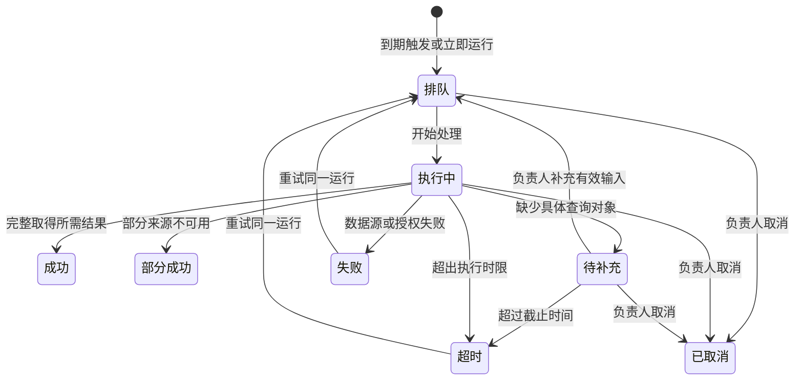

# teleConnect 145 更新说明与交互验收

更新日期：2026-10-30（Asia/Shanghai）

原型：`teleConnect_AI主动模式原型_145.html`。以 144 为完整基线增量构建，142、143、144 文件不覆盖。客户端继续使用 teleConnect 的既有风格，保留群聊、私聊、五个 AI 会话、AI 助手历史提醒、主动服务、业务处理、文件、模型、分享及全部后台原有模块。本次移位的是两个常驻聊天按钮，其背后的功能仍可使用。

下文说明 145 已实现的本地原型交互。文末附完整 144 累计说明；历史章节中的“待实现”是当时状态，以本节为最新结论。此 HTML 没有连接真实组织、业务或通知后端。

## AI 内任务看板与权限

从 AI 会话顶部图标或“更多 → 任务看板”进入，固定当前 AI；不再显示“全部 AI”。从侧栏 My tasks、AI 助手或气泡的全局任务入口进入，可查看授权的跨 AI 任务。测试 AI 会话继续按自己的会话标识隔离。

普通成员保留搜索、来源、与我的关系，时间放更多筛选。部门负责人在客户端展开更多筛选后，可选择授权部门内的负责人、审批人或参与人。后台直接展示组织筛选。菜单、按钮、详情与统计使用同一权限规则。

| 演示身份 | 任务查看范围 | 组织筛选 | 模板发布 |
| --- | --- | --- | --- |
| admin | 已授权组织与领域 | 全部演示部门、成员 | 已授权领域 |
| Chang | OSS 运维部 | 本部门 | OSS 领域 |
| Dawit | OSS 内本人负责、参与、申请或审批 | 不展示部门成员枚举 | 可保存草稿，不可发布 |
| 示例用户 1 | 经营分析部 | 本部门 | 经营分析领域 |
| 示例用户 2 | 经营分析内本人相关任务 | 不展示部门成员枚举 | 可保存草稿，不可发布 |
| 示例用户 3 | 协作服务内本人相关任务 | 不展示部门成员枚举 | 可保存草稿，不可发布 |

以上为原型演示映射，同时遵守已有 AI 启停与黑白名单；不是实际公司组织授权。原型提供三个平级责任部门，生产接入现有部门树并由服务端返回授权部门及成员。权限说明可在看板直接打开，演示设置可切换身份；后台右上角显示实际演示身份和角色。

切换身份清空旧范围和成员条件，关闭旧详情。改变部门清空之前选中的成员，回到第一页。审批权限独立于查看权限：管理员也不能代替指定审批人提交。

## 筛选、统计和通知的一致性

- 有效任务集合先应用角色、授权领域、AI 访问规则，再应用入口范围和筛选条件。任务按稳定 ID 去重。
- 所有统计卡随普通筛选变化；点击状态卡只筛选明细，不使其他状态卡全部变成零。全部任务、当前结果数和完成未读分别展示。
- 客户端统计保留“待我处理、待我审批”；后台为当前组织筛选范围的“待处理、待审批”。
- 完成未读只属于结果接收者，不能把部门成员的未读累加成管理员自己的红标。气泡、AI 列表、当前 AI 入口、结果列表及看板使用同一完成事件。
- 查看列表、打开更多、打开看板不清除未读；客户端打开具体结果后才同步清除。后台只读查看不代替接收者标记已读。
- 审批结论写入单独的 AI 助手提醒，明确标为“审批结果 · 非任务完成”，不增加完成红标。通过后是执行中，执行并验证成功后才完成；失败保持处理中。
- 审批确认页记录任务修订号，提交再次校验指定审批人、当前状态、超时、负责人和修订号。驳回要求填写原因，历史记录保留，重新提交建立新审批单。

## 顶部入口修复与聊天简化

已修复“更多菜单中的任务看板按钮导致顶部按钮不渲染”的问题。顶部按钮有独立标识，展开或收起更多均可见。看板使用分栏图标，我的业务保留清单图标，主动服务保留无文字时钟图标。原有菜单项全部保留。

普通聊天不再常驻“上下文：仅本次问题与附件”和“文件与解析状态”两个按钮。

- AI 会话输入区新增小型设置入口“AI 使用范围与附件”；群聊和私聊继续通过“我的 AI · 会话辅助”进入。
- 默认只使用本次问题与所选附件。主动选择最近两条可见消息后，输入区显示可撤销提示；取消提示恢复默认范围。
- 附件卡继续显示解析状态、正文与来源；解析失败可重试恢复已有本地正文，无可恢复正文时提示重新选择文件。无附件不显示文件状态条。
- 文件管理仍保留在附件功能、侧栏 Files 和 AI 面板。DOCX/XLSX/PPTX 样例及失败/撤权模拟移到演示设置，不作为业务聊天的常驻入口。
- 群聊 @ 成员及 AI、私聊仅 @ 我的 AI、AI 草稿确认发送、文件 AI 询问等原有交互继续保留。

## 业务实例发布为场景模板

业务实例列表与流程编排工具栏均新增“发布为场景模板”，不替换试运行、编辑、复制、删除等原操作。

交互流程：

1. 在实例列表或流程编排中选择发布为场景模板。当前有未保存修改时，先保存草稿再继续。
2. 填写模板名称、说明、可见范围；选择另存新模板或发布已有模板的新版本。
3. 展示需要在新实例中重新绑定的人员与固定资源参数，以及当前配置阻断项。
4. 检查并预览节点、连线、参数数量。无发布权限或有阻断项时可保存草稿，不能发布。
5. 发布后可查看场景模板，或直接从该版本创建业务实例。
6. 创建时重新选择授权且符合领域的成员，填写资源参数；创建结果是草稿，自动打开配置检查，不启动定时任务或业务运行。

模板保存来源实例、配置摘要、模板版本、发布人、可见范围及依赖快照。运行记录、审批结论、消息、个人附件与凭据不复制。固定人员池和资源编号转为待绑定参数，接口请求 JSON 内的固定资源编号也参与参数化；凭据字段移除，连接引用保留并重新校验。

当前多人节点在创建时选择一个初始授权成员，原有节点编辑器仍可调整候选人员池、分派规则、权重及通知接收人。实例创建时不会复制原来的个人授权。真实资源是否存在以及是否可访问，需要生产服务端验证。

新版本独立保存，旧版本与原实例不被覆盖；从已发布的 145 模板进入编排保存时生成新版本。依赖状态或契约变化后会阻止使用旧快照创建实例，需检查并重新发布。原有模板管理与原有从模板创建流程继续保留。

## 配置检查与试运行结果

原“检查通过”改为有状态的配置检查入口：待检查、配置检查通过、有警告、有阻断项、配置已修改待重查。检查结果绑定配置内容和依赖摘要。

保留既有开始节点、连线、必填配置、变量引用、智能体、消息服务、审批人员与超时、定时参数等校验，增加：

| 类别 | 已实现的原型检查 |
| --- | --- |
| 流程结构 | 开始节点唯一、重复节点 ID、失效连线、意外环路、明确结束节点、无后续路径、同一出口重复连线 |
| 数据绑定 | 原有上游引用与必填校验；请求 JSON 的数字、布尔、字符串、数组、对象常量类型检查；未绑定模板参数阻断 |
| 审批与异常 | 审批通过/驳回/超时出口；明确要求人工确认的执行节点是否存在绕过通过出口的路径；重试参数与副作用提示 |
| 依赖 | 智能体和服务有效性、子流程自引用及发布状态、模板依赖快照变化 |
| 试运行 | 保存实际样例路径、到达节点、结果、时间和配置摘要；修改后旧记录明确标为需重测 |

检查面板区分阻断、警告和待验证，每条可定位相关节点。阻断项禁止发布或试运行；警告需人工核对；真实接口、AI、组织鉴权及系统通知始终单列为待联调，不能由静态检查自动变成验收通过。

现有两个示例流程（“基站故障预测 → 一键派单”“会后纪要与待办”）缺少完整审批出口，新增检查会提示补齐；原示例内容保留，没有为了使检查变绿而删除或改写。其他 11 个原有业务实例在本轮配置检查中未发现阻断项。

检查不自行请求生产接口。原有试运行继续使用其原配置与样例处理逻辑；本轮创建的模板副本试运行实际到达“监控问题待核查”，保存了调用失败与待人工处理结果，没有声称真实业务已成功。

## 后台任务中心与数据量

后台默认分页列表，保留可切换的分栏看板。统计、过滤和详情保留关联；不再一次铺开全量卡片。

- 常用条件：来源、授权 AI、与我的关系、责任部门、成员职责及成员。时间与排序在更多筛选。
- 成员职责可选负责人、审批人、参与人；部门默认为当前责任部门，避免与发起人部门混算。
- 表格展示名称/编号、来源/AI、责任部门、负责人/审批人、当前节点/状态、截止/更新时间及详情。
- 支持 20/50/100 条分页、待办与逾期优先、最近更新、截止时间排序。表格区域独立滚动，表头与分页保持可访问。
- 分栏按状态每列先展示 10 项，可独立加载更多。不能拖拽跳过审批。
- 点击任务打开完整详情，关闭后保留筛选与页码；查看原有完整详情和流程入口继续存在。
- 演示设置中，admin 可增加 60 项明确标记的分页样例，不删除原任务，也不为这些历史样例产生完成通知。

HTML 在本地集合上模拟分页。生产必须由服务端先鉴权，再执行分页、排序和聚合；不应先下载全量任务再前端筛选。本轮并未实现生产查询 API 或大规模数据压测，该边界也显示在后台看板旁。

## 嵌入 teleConnect

145 保留 `?embed=1` 模式与原有容器适配。真实会话、身份、附件权限及原生通知仍由 teleConnect 宿主提供。示例身份切换和开发检查入口属于原型演示，不作为正式客户端新增业务入口。

原生 Mac 通知、Windows 任务栏提示、退出应用后的调度、跨窗口/跨设备事件同步沿用此前说明，仍需宿主和服务端接入。HTML 中的动效及通知模拟不代表已经实现真实 OS 能力。

## 本轮验证与检查路径

已完成 37 项自动逻辑/DOM 检查，覆盖原数据保留、角色范围、AI 范围、部门与成员过滤、审批权限/修订、执行后通知与已读联动、模板发布/创建/版本保留、刷新恢复、结构/类型/审批/依赖检查、JSON 参数化及凭据剔除。

已完成浏览器操作：

- 展开更多仍保留顶部图标；AI 内看板不显示全部 AI。
- 普通成员无部门/成员筛选，部门负责人只见本部门；后台顶栏同步当前身份。
- 指定审批人填写意见、确认通过，待我审批减少、进行中增加，完成未读不增加。
- 后台 65 项任务分页，第二页切部门后回到第一页，成员候选和结果同步收窄。
- 从业务实例发布模板，预览参数，重新绑定人员并创建草稿，打开配置检查和原有试运行。
- 原客户端与后台风格、导航、业务表格、流程画布、原有操作继续可见。

自动检查不等于所有历史模块逐项手工回归。没有将真实组织鉴权、真实系统通知、生产模型/接口、服务器分页性能作为通过项。

建议检查顺序：客户端 OSS 顶部看板 → 更多筛选 → 演示设置切 Dawit / admin → 后台任务看板 → 演示设置添加分页样例 → 业务实例发布为场景模板 → 从模板创建并重新绑定 → 配置检查 → 审批详情。

验证文件：`.prototype145/test.cjs`、`.prototype145/verification.json`。截图保存在 `.prototype145/qa/`。


---

# 144 及之前的完整历史说明

以下为历史原文保留。其待实现状态仅指 144 评审时点；145 的完成情况和边界见本文前半部分。

# teleConnect 144 TMD：142 之后全部更新

版本：144  
日期：2026-10-29  
直接基线：`teleConnect_AI主动模式原型_143.html`  
交付原型：`teleConnect_AI主动模式原型_144.html`  
本文包含 144 最新行为和完整的 143 累计说明。142、143 HTML 及 143 MD 均保留，不覆盖。

144 是本地交互原型，群聊、私聊、任务、审批、通知都使用演示数据。没有接入真实 teleConnect 通讯、业务服务、设备执行或原生系统通知。新增群聊与私聊文本为虚构示例，不复制真实聊天内容。

## 本次更新与原有能力保留

| 页面 / 功能 | 144 的变化 | 保留内容 |
| --- | --- | --- |
| 群聊 OSS agent Integration | 组合头像、群组信息、发言人、普通消息气泡、通话入口、独立 AI 辅助入口 | 原附件 A.docx、文件 AI 选择、消息记录、分享、历史、搜索、成员与 AI 提及、草稿确认 |
| 私聊 Girum Mesfin Agonaf | 联系人头像、私聊状态、左右气泡、示例发送状态；默认输入区不展示 AI 模型与 Cowork | @ 我的 AI、文件、上传、历史、搜索、AI 模型和上下文选择（移入 AI 辅助面板） |
| AI 会话 | 顶部主动服务只保留图标；完成未读红标独立点击 | 原五个 AI 会话、Chat/Cowork、我的业务、知识案例、主动服务模板与任务、运行记录 |
| 悬浮气泡 | 常驻“已完成任务 N 未读”“任务看板”；取消绿色完成对勾 | 原主窗口、翻译、字幕、我的 AI、隐藏、禁用和独立 AI 窗口 |
| AI 助手 | 加入完成结果、待我审批、任务看板入口 | 原 ERP、telebirr、会议、邮件、业务任务提醒均保留，新结果追加 |
| My tasks | 打开统一任务看板；可切回原有业务列表 | 原业务处理、更新进展、转派、AI 答疑、流程查看、分页、搜索 |
| 后台业务引擎 | 新增任务看板，与客户端使用相同任务数据 | 原业务实例、场景模板、运行记录、知识案例、消息服务及其他全部后台模块 |
| 任务详情 | 关联运行 / 业务任务 / 审批单，增加审批交互和记录 | 完整运行详情、来源、配置版本、处理记录和原有完整任务详情入口 |

本次未扩展 P2。不是用新列表替换原有页面：143 HTML 主体仍作为基线包含在 144 中，新增逻辑通过独立扩展层接入。

## 群聊和私聊如何与 teleConnect 对齐

群聊默认是通讯界面，不再使用 AI 对话的 Deep Thinking、模型选择或默认 Chat/Cowork 切换。消息展示发言人、正文、时间和附件；原有内容分享与复制继续可用。群组信息包含成员、Media and docs、Chat History、Search within chat、Check All Meetings 入口。

私聊显示联系人与普通会话。普通发送只新增自己发送的消息，不再自动插入模拟 AI 回复。发送状态标明“示例”，不伪造实际已读回执。触发 @ 时仅出现“我的 AI”，没有“全部”“成员”。群聊仍保留成员与 AI 选择。

点击输入框旁的 AI 图标，打开“我的 AI · 会话辅助”。选择机器人后回填 @；此时才出现本次 Chat/Cowork 选择。模型、上下文和文件解析状态在该面板内保留。生成的内容依旧先进入仅自己可见的草稿，支持编辑问题、重新生成、编辑回答、取消、确认发送，沿用 143 的权限与失效校验。

语音、视频、群组会议入口可打开对应说明。HTML 不发起真实呼叫；生产由 teleConnect 宿主按当前会话 ID 调用原生能力。实际成员数量、在线状态、消息顺序、发送失败重试和已读回执也由宿主提供。

## 完成未读：统一口径和入口

“完成未读”统计当前用户尚未打开的完成结果，不等于启用中的计划数、消息总数、审批待办数或历史累计完成数。

- 主动服务成功、部分成功：以唯一 Run ID 对应一条完成结果；同一运行重试不会新增重复结果项。
- 流程业务任务从未完成变为完成：产生唯一业务完成事件，关联 taskId；存放在业务完成事件集合中，不伪装成主动服务运行。
- 既有历史完成任务初始化为历史数据，不追溯制造新红标。
- 失败、超时、取消、待补充不计入完成未读；原有异常提示与状态继续保留。
- 每条完成结果有唯一归属 AI 会话。ossAITest、bigDataAITest 不复制主 AI 的数字。普通调度默认归属对应主 AI；从测试会话手动运行时按发起会话归属。
- 后台查看审计或任务详情不代客户端标记已读。

| 入口 | 数字含义 | 点击行为 |
| --- | --- | --- |
| 右下角气泡 | 全部 AI 完成结果未读总数 | 打开原气泡菜单 |
| 气泡菜单“已完成任务” | 同一全局总数 | 打开完成结果列表，默认仅未读 |
| 完成提示“查看全部” | 同一全局总数 | 同一完成结果列表 |
| 我的 AI 文件夹 / 展开后标题 | 全部 AI 完成结果未读 | 点击数字进入全局完成结果列表 |
| 各 AI 会话右侧红标 | 该会话所属结果未读数 | 点击数字进入该 AI 的完成结果列表；点击会话行仍进入聊天 |
| AI 会话顶部图标旁红标 | 当前会话所属结果未读 | 点击数字查看结果；点击图标管理主动服务 |
| AI 助手入口红标 / 页内完成结果按钮 | 全局完成结果未读 | 打开同一完成结果列表 |
| 看板“完成未读” | 当前用户可读的完成结果映射到任务项 | 筛选相应任务，打开卡片查看详情 |
| AI 助手的原有消息提醒 | 全部类型的提醒阅读状态 | 继续沿用原有提醒内容；与完成未读明确区分 |

打开列表、关闭气泡提示、切换 AI 不减少数字。打开有权限的具体完成结果才标记已读，气泡、AI 列表、标题栏、AI 助手和看板同步更新。详情可返回原结果筛选；看板筛选、布局及横向滚动位置在打开详情时保持。

主动服务页面“已完成”标签始终显示完成运行总数，另行显示未读数，不再根据有无未读切换数字含义。它只统计主动服务运行；统一完成结果列表同时包含流程业务完成事件。

## 统一任务看板

客户端入口包括 My tasks、对话顶部任务图标、会话菜单、原有业务列表、AI 助手和气泡菜单。后台在“业务引擎 → 任务看板”。所有入口使用同一数据投影，不复制任务，也不生成第二套审批单。

默认展示本人参与的任务；后台为演示全量视图，但审批按钮仍按当前演示用户校验，不以页面上的 admin 标识自动赋予审批权。后台看板注明当前审批身份。

统计项可点击：待我处理、待我审批、进行中、已逾期、已完成、异常。待我处理指本人负责且待处理 / 待补充的任务；待我审批指指定本人且审批仍待处理的任务；逾期不包含已完成和已终止任务。统计是当前权限范围的概览，下面的组合筛选用于筛选任务卡。

状态列为：待处理、进行中、待审批、待补充、已完成、异常 / 已终止。小容器可横向滚动，或切换列表视图。支持任务名称 / 编号 / 负责人搜索、来源、AI、负责人、审批人、开始和结束日期筛选及重置。

每张卡片可点击，展示来源、AI、负责人、审批人（待审批时）、任务编号、截止时间和逾期状态。一次主动服务执行占一项；一个业务任务占一项；审批作为关联状态显示在该业务任务上，不将父任务和审批单重复计算。订阅计划是配置项，不直接等同于一次已执行任务。

业务详情显示实际关联实例编号（不存在时明确未绑定）、所属流程、taskId、当前节点、负责人、期限、说明、处理记录和审批。原有“完整任务详情”“查看流程”等入口继续保留。运行详情保留 Run ID、版本、触发方式、数据来源、时间线以及运行操作。

## 审批交互

新增两条明确标注的演示任务，便于检查双方视角：

- 接入光路恢复操作：admin 发起，Chang 审批。
- 现场工单转派：admin 审批，Chang 为申请人。

左下角“144 · 演示设置”可以切换身份。它仅切换本地演示数据视角，不登录实际系统、不授予真实权限。

审批详情呈现申请操作、申请人、指定审批人、风险与影响、输入快照、截止时间、意见和历史。非指定审批人仅能查看，意见框禁用。原有业务列表、AI 助手和看板中的审批任务都进入统一审批详情；原有完整任务详情仍可另行查看。

通过路径：打开任务 → 核对对象和风险 → 填写意见（可选）→ 通过审批 → 确认页 → 确认提交 → 进入处理中 → 负责人执行与验证 → 成功后完成。审批不直接代表业务恢复。

驳回路径：填写原因（必填）→ 驳回 → 确认提交 → 退回申请人处理 → 补充申请依据 → 重新提交。新审批单与旧审批单均可追溯，旧意见不被覆盖。

提交时重新检查审批是否仍待处理、当前审批人、任务状态、任务负责人及审批超时。原有任务继续调用 143 的业务策略校验与操作逻辑；新增演示任务使用本地演示闭环。不可拖拽任务卡跳过审批。

执行失败时保留处理中并记录失败；成功且验证通过才标为完成并产生完成通知。本地演示可以选择失败或成功分支，未执行真实操作。生产需要服务端原子校验、幂等键、乐观锁、审批策略版本与执行结果回传。

## 嵌入与通知的开发约定

默认 HTML 保留 teleConnect 桌面外观供评审。加 `?embed=1` 可检查内嵌布局：移除演示桌面标题栏，取消旧版 1280px 最小宽度，按容器调整会话区、筛选区与任务列。已在 1100×760 与 760×720 视口检查页面宽度不溢出；这不等于完成实际宿主集成。

宿主应传入已登录用户、租户、会话类型 / ID、成员与选定附件；AI 页面不能自行读取其他聊天。需要约定的事件（建议契约，不是现有接口）：

| 事件 | 关键字段 | 页面响应 |
| --- | --- | --- |
| task.updated | taskId、instanceId、状态、负责人、版本、时间 | 更新原任务卡、统计和详情 |
| approval.updated | reviewId、taskId、状态、审批人、意见、版本 | 更新审批详情与待我审批数 |
| result.completed | resultId、来源类型、runId 或 taskId、AI 会话 ID、接收用户 | 去重加入结果与未读，呈现完成提示 |
| result.read | resultId、userId、readAt、版本 | 全部客户端入口和打开的 AI 窗口更新数字 |
| notification.open | resultId、目标用户、租户 | 校验身份和权限，再定位结果；不自动执行任务 |

macOS 横幅、通知中心、Dock 数字，以及 Windows Toast、任务栏闪烁与进度效果仍由原生宿主实现。本原型保留“通知效果说明”的权限拒绝、勿扰、后台、隐私与平台切换演示。完成状态不再增加绿色对勾；运行中保留原旋转动效，异常提示保持区分。

本地单页和其内的浮动 AI 窗口共用内存状态。跨进程、跨标签页、跨设备的实时同步需要服务端推送或宿主消息桥，原型没有声称已经实现这些能力。纯 HTML 关闭后也不会执行定时任务。

## 存储与升级

144 使用独立 localStorage 与 IndexedDB 名称，偏好和旧内容分享存储也使用新名称，不写入 143 存储。首次打开时，如同源可访问 143 的保存数据，会只读复制至 144；否则使用完整内置基线。浏览器、协议、域名和端口不同会影响能否读取历史数据，不能保证跨浏览器迁移。

新增业务任务、审批记录、业务完成事件和结果阅读状态随 144 演示数据保存。143 的消息、草稿、服务、运行、分享、机器人配置和文件处理继续沿用原保存机制。若持久存储被浏览器拒绝，仍保留原导出备份入口与说明。

## 本轮已执行验收

- HTML 中全部脚本语法检查通过；纯逻辑测试覆盖结果去重、用户隔离、测试会话隔离、阅读同步、审批身份 / 状态 / 超时及看板筛选。
- 浏览器实际执行“立即运行 → 排队 → 执行 → 完成 → 红标同步 → 打开结果 → 红标消除”。确认原三个 OSS 主动服务、六个模板及原菜单仍可见。
- 验证群聊的旧 A.docx 文件卡片和三项 AI 选择列表；验证私聊 @ 仅出现我的 AI；普通私聊发送没有额外 AI 回复；AI 请求产生未发送的私有草稿。
- 验证审批缺少驳回意见时阻止提交、通过后进入处理中、非审批人只读、执行失败保留处理中、业务验证成功产生完成通知。
- 验证驳回后重新提交生成新审批单并保留旧意见；后端看板与客户端使用相同审批结果。
- 确认 AI 助手保留 ERP、telebirr、会议、邮件和旧业务提醒；后台保留完整导航。
- 检查内嵌 1100×760、760×720 宽度，无页面级横向溢出。看板状态列按设计内部横向滚动。
- 142 与 143 文件 SHA-256 保持不变；144 是单独文件。没有逐个重新执行 142 的所有建模及外部 HTTP 功能，不能把“保留源实现”理解为所有生产接口已回归。

评审截图保存在 `.prototype144/qa/`。浏览器检查未观察到原型自身脚本异常；浏览器扩展自身的报错不纳入原型功能结果。

## 建议检查顺序

1. 群聊与私聊之间切换，检查消息、附件和 AI 入口；在私聊输入 @ 检查范围。
2. OSS agent 顶部时钟图标 → 选择早间网络巡检 → 立即运行，观察气泡与 AI 列表数字。
3. 点击气泡 → 已完成任务 → 查看结果，再观察数字消除；已完成任务仍能切到“全部完成结果”找到。
4. My tasks → 待我审批 → 接入光路恢复操作，尝试空原因驳回、通过审批，并查看记录。
5. 演示设置切到 admin → 同一任务 → 执行与验证，分别检查失败、成功；回到气泡查看业务完成结果。
6. admin 驳回现场工单转派，切回 Chang 修改并重新提交，查看旧、新审批单。
7. 管理后台 → 业务引擎 → 任务看板；运行详情中的审计入口仍为 Q&A Log，不跳转客户端。

## 143 累计说明原文（历史基线）

以下完整保留 143 MD。涉及 144 已调整的内容，以本文前半部分为准，尤其是完成对勾、主动服务图标文字、群聊 / 私聊默认工具条和未读统计方式。

---

# teleConnect 143 TMD：142 之后全部更新

版本：143，任务通知与审计交互修订版  
日期：2026-10-29  
基线：`teleConnect_AI主动模式原型_142.html`  
交付原型：`teleConnect_AI主动模式原型_143.html`

本文是累计技术设计说明，覆盖 143 初次补充的 P0/P1、恢复 142 界面与内容的修订，以及本次任务通知、任务菜单、私聊提及和后台审计调整。以当前 143 的最终行为为准，不能用早期 143 的简化页面替代最终界面。142 文件未修改。

“原型已实现”指本地 HTML 可操作的交互与状态；“生产需接入”指开发约定，不代表真实服务已完成。AI、业务接口、定时调度、跨用户投递及系统通知均未与生产系统联通。本文不承诺 HTML 关闭后仍能执行任务。

## 交付范围与保留原则

| 分类 | 当前范围 |
| --- | --- |
| 已有能力复用 | teleConnect+ 客户端布局、Chat/Cowork、原有五个 AI 会话、我的业务、主动服务、知识案例、聊天历史、模型入口、文件问答、悬浮多窗口、看板入口、后台完整导航及原有表格和编辑器 |
| P0 补充 | 机器人与访问控制衔接、内嵌页面异常恢复、模板/订阅/运行分离、配置版本快照、调度去重、来源与结果状态、草稿确认及执行边界 |
| P1 补充 | 补充信息后续跑、AI 助手聚合、文件解析状态与引用、受控分享、任务通知与未读计数、立即运行、Q&A 审计关联 |
| 本轮明确调整 | 后台删除客户端续聊行为；私聊只 @ 我的AI；独立主动服务入口；运行/完成提醒及系统效果说明；任务操作菜单 |
| P2 暂不扩展 | 通用对象图谱、周期性全量资源抓取维护、复杂业务编排、自主闭环执行等。142 中已有相关页面和功能入口保留，本轮不新增其逻辑 |

客户端保留原有会话与消息内容，包括五个 AI 会话、AI 助手原有六条示例提醒、原来的业务与案例入口。主动服务沿用 142 的模板、我的业务、搜索、分页、详情和表单。后台沿用 MESH 风格、分组菜单、模板和实例表格；原有七条订阅保留。新增内容进入原有页面，不用简陋独立列表替换整套功能。

## 累计变更总表

| 页面/功能 | 142 之后的最终变化 | 验收重点 |
| --- | --- | --- |
| 机器人配置与我的AI | 配置机器人映射到可用 AI；启停、访问名单与用户身份参与入口和调用校验；保留原五个会话 | 被停用或拒绝访问的机器人不能继续调用；切换身份不继承他人私有数据 |
| OSS/Big Data 内嵌页 | 正常、加载中、失败、登录失效状态及恢复入口；保留原 Chat/Cowork、历史、看板操作 | 加载失败不能表现为空白成功；刷新恢复不混入其他 AI 的内容 |
| 主动服务表单 | 查询范围、统计区间、通知策略、配置版本；原周期、时区、生效区间等继续可用 | 保存仅改变后续运行；历史运行仍读旧快照 |
| 调度与运行 | 唯一运行标识、重复触发去重、同任务未结束运行保护、暂停/恢复、立即运行 | 多次点击不创建并发重复任务；手动执行不修改定时计划 |
| 结果和来源 | 成功、部分成功、无数据、失败、超时、待补充、取消；来源标识和取得时间 | 查询失败不解释为业务正常；摘要成功不等于工单或故障已关闭 |
| 信息补充 | 明确负责人、具体输入、截止时间；继续同一 Run ID | 输入留在本次运行，不能自动成为资源主数据 |
| AI 助手 | 原提醒加上新运行提醒，按身份展示，结果关联运行 | 不删除原消息；未读与业务状态分开 |
| AI 草稿 | 私有生成、编辑问题/答案、重新生成、发送校验、失败保留、避免重复发送 | 确认前不发到会话；更改问题后的过期答案不能直接确认 |
| 文件问答 | 文件编号/版本/解析状态、正文来源、权限复核；修复文件 AI 列表遮挡 | 不可提问的文件不得被当作已读正文；列表不越界裁切 |
| 分享 | 固定快照、明确接收者、有效期、撤销、只读答案或独立续聊 | 分享不转移附件权限，不修改发送者会话，不自动创建订阅 |
| 后台审计 | 查看 Q&A Log 替代“在会话中继续”；新增运行到审计记录关联 | 后台始终留在后台，只读，不消耗客户端未读状态 |
| 私聊 @ | 单列“我的AI”，去掉全部和成员；群聊维持原逻辑 | 私聊键盘/鼠标均只能选 AI；群聊仍能选成员 |
| 聊天顶部 | 主动服务图标与文字独立放在 Chat/Cowork/返回对话旁，带红标 | 保留会话菜单；打开列表不清零，查看具体完成结果才减少 |
| AI 小气泡 | 排队/执行动效、完成勾选、任务名提示、需处理状态、结果入口 | 成功与失败清晰区分；关闭提示不等于已读 |
| 任务菜单 | 暂停/恢复、立即运行、编辑、分享、删除 | 每项都进入实际交互；删除前说明历史保留规则 |
| 本机保存 | 143 独立数据、压缩重复头像、localStorage/IndexedDB 回退、导出备份 | 保存异常不一概误报空间不足；不覆盖 142 数据 |

## 客户端：主动服务入口和结果查看

位置：AI 会话顶部右侧，在 Chat/Cowork 或“返回对话”按钮旁增加时钟图标与“主动服务”。保留右侧会话菜单、我的业务与知识案例入口。

点击后进入原 142 风格的主动服务页。有未读完成结果时定位“已完成”，否则进入默认服务视图。原模板、我的业务、已启用筛选继续存在。原先将“启用的计划”写成“运行中”的标签改为“已启用”，避免把定时计划状态与一次运行状态混淆。

“已完成”展示成功和部分成功的运行。搜索任务名称或编号；列表分页；查看运行可看来源、时间线与固定配置。未读时页签数字强调未读量，全部已读后显示完成总量，页脚明确总量和未读量。标题处红标仅表示未读完成结果。

红标计算规则：当前用户拥有、当前 AI 范围内、状态为成功或部分成功、尚未查看的运行数。右下角 AI 气泡汇总当前用户所有 AI 的完成未读数。大于 99 显示 `99+`。失败、超时、取消、待补充不计入“已完成”红标，但仍保留提醒与运行记录。

打开服务列表、切换页签、关闭浮层不减少未读。点击具体结果，或客户端进入该运行会话后，该运行标为已读并同步 AI 助手提醒。后台读审计不改变用户已读。运行中提前查看，不代表未来完成结果已读。

## 客户端：任务操作菜单

每条任务右上角增加“⋯”，使用与现有界面一致的圆角、间距与颜色；“立即运行”也保留为明显的行内按钮。后台实例行同样增加操作入口，但不会跳到客户端。

| 动作 | 触发与处理 | 结果及异常 |
| --- | --- | --- |
| 暂停 | 启用任务 → 菜单暂停 | 停止未来定时触发；已开始的运行继续。暂停不等于取消运行 |
| 恢复计划 | 已暂停任务 → 恢复计划 | 重新计算未来计划；不补跑暂停期间所有周期 |
| 立即运行 | 启用任务 → 校验身份、AI 和配置 → 创建一次手动运行 | 保持周期与下一计划不变；已有排队/执行/待补充运行时打开原运行，不再创建 |
| 暂停时立即运行 | 已暂停任务 → “立即运行一次”确认框 | 确认后只跑一次，任务仍暂停；取消则不创建运行 |
| 编辑 | 打开原 142 编辑表单，修改名称、指令、计划、范围或通知方式 | 保存生成新配置版本；旧运行快照不变；未保存离开有提示 |
| 分享 | 生成任务配置的只读内容快照；选择接收者和有效期 | 不自动创建对方订阅，不转移负责人或执行/文件权限；可撤销 |
| 删除 | 显示名称与后果，二次确认 | 停止未来计划，任务退出列表；历史运行、Q&A Log、已发结果保留。进行中的运行继续，需停止时另行取消 |

草稿未完成配置时不得运行。机器人停用或访问资格变化时重新校验，显示明确原因。运行中的编辑只影响下一次运行。生产端应使用配置版本进行并发更新检查；出现版本冲突时提示重新加载，而非覆盖他人修改。

原型没有向外部系统发送分享或删除生产任务；当前菜单处理的是本地演示数据。

## 一次运行的完整状态流程



| 状态 | 需要显示 | 可操作项 |
| --- | --- | --- |
| 排队 | 任务名称、正在准备、本次 Run ID、旋转动效 | 查看详情、取消当前运行 |
| 执行中 | 正在读取授权数据/整理结果与来源；无虚假百分比 | 查看详情、取消当前运行 |
| 待补充 | 缺什么、谁补充、截止时间、输入框 | 输入并继续同一次运行、取消 |
| 成功 | 完成勾选、名称、摘要、来源、取得时间 | 查看结果、客户端继续提问、后台只读审计 |
| 部分成功 | 部分完成提示、成功来源及缺失来源、结论范围 | 查看结果；不能包装成完整成功 |
| 失败/超时 | 原因、未取得结果的说明、时间线 | 重试原运行；不增加完成红标 |
| 已取消 | 取消记录、未来计划未改变的说明 | 查看历史；迟到回调不得改为成功 |

本地运行按约 0.65 秒开始读取、2.3 秒整理、4.4 秒产生结果演示。真实系统必须按后端事件推进，不能照搬这些时间作为业务耗时。

重试保留 Run ID、配置快照、原失败记录，尝试次数增加；原型最多 3 次尝试。信息补充使用原 Run ID，输入 2–200 字的具体对象，演示截止时间为 24 小时。补充不会修改订阅，更不会维护全量资产台账或自动写入图谱。生产需按领域定义更精确的输入结构和超时策略。

无数据是“查询成功但本范围内无数据”；访问拒绝是失败；部分来源失败是部分成功。不得互相替代。成功只表示本次 AI 摘要完成，不表示修复设备、关闭工单、发送邮件或分配行动项。

## 客户端：右下角 AI 气泡与完成通知

任务开始后，气泡外缘显示旋转动效，旁边展示任务名和当前阶段；点击可打开对应运行。任务成功后显示勾选完成标记及“XXX任务已完成”；部分成功显示“任务部分完成”；失败、超时、待补充使用需处理提示。气泡本身原有 AI 菜单与窗口入口保留。

提示提供“查看结果”“关闭任务提示”“通知效果说明”。关闭仅隐藏当前提示；结果和红标继续保留。查看结果标记该运行已读。多条提醒在同一面板内显示，最多展示三条；更多内容从“查看全部”进入运行列表，避免不断堆叠覆盖主工作区。

任务结果、提示展示和已读是三种独立状态。事件去重以运行、尝试次数、状态为依据；同一完成事件不会重复累加未读。重新加载页面保留结果和未读，但不重新弹出已存提示。页面关闭时尚在本地执行的任务恢复后标为中断失败，允许手动重试，不偷偷重放请求。

通知策略沿用任务配置：每次结果、结果变化时、仅异常或待处理。策略控制是否产生主动提醒；完成历史与完成未读计数仍可查看。系统勿扰、通知拒绝不应丢失应用内结果。

## Mac 与 Windows：原型可演示什么、客户端必须实现什么

入口紧邻气泡：“通知效果说明”；也可从“143 · 演示设置”进入。可以选择平台、前台/后台模拟、通知允许/拒绝/勿扰、隐藏或显示任务名称，以及下一次立即运行的成功/部分成功/待补充/失败/超时结果。

HTML 已实现页面内的 macOS 通知卡片、Windows 通知与任务栏闪烁示意、点击模拟通知打开对应结果。**它不会调用系统通知权限，也不会改变真实 Dock 或 Windows 任务栏。** 不应把截图中的页面示意当作操作系统已收到消息。

| 场景 | macOS 正式效果 | Windows 正式效果 | 原型表达 |
| --- | --- | --- | --- |
| 运行中 | 客户端内气泡阶段与加载动画 | 客户端内动画；任务栏可显示不确定进度 | 已实现应用内阶段与动效 |
| 前台完成 | 显示任务完成提示；是否同时系统横幅按客户端通知偏好 | 显示应用内完成提示，避免主动抢焦点 | 已实现气泡和红标 |
| 后台/最小化完成 | 请求系统横幅/通知中心送达；可同步 Dock 未读徽标 | 系统 Toast，任务栏请求闪烁；不把应用强行置前 | 可选页面内两种平台示意 |
| 点击通知 | 激活 teleConnect+，校验登录/任务权限，定位 Run ID 结果 | 激活客户端并定位结果，停止提示性闪烁 | “模拟点击系统通知”打开同一结果 |
| 拒绝通知 | 不反复请求，应用内保留未读；可提供系统设置指引 | 应用内保留未读；系统横幅不可保证 | 显示拒绝原因，不提供虚假的通知点击按钮 |
| 勿扰/专注模式 | OS 可能静默处理；不承诺横幅即时出现 | OS/用户设置可能抑制 Toast 或闪烁 | 显示说明，结果仍可查看 |
| 客户端完全退出 | 任务由服务端继续执行；通知取决于批准的推送或后台运行架构 | 同左，不能靠已关闭的网页执行 | 明确标注不支持后台真实执行 |
| 账号退出或访问撤销 | 先登录/校验，再决定是否能打开；不可泄露结果 | 同左 | 开发要求；未进行真实 OS 联调 |
| 多条同时完成 | 合并通知并指向未读列表，保持单条运行索引 | 合并 Toast/计数，避免无限闪烁 | 面板限制三条并提供全部入口 |

原生适配必须记录通知投递与交互回执，任务成功不能因系统通知被拒绝而改成失败。激活应用后停止提示性闪烁，但只有查看具体结果才减少该条未读。点击 OS 通知只打开结果，不能自动运行、重试、发送消息或执行设备操作。

通知默认支持隐藏任务名和业务正文。锁屏场景需遵从用户隐私设置；即使展示任务名，也不直接在系统通知里暴露告警详情、财务数值、附件正文和凭证。通知载荷只携带必要标识及展示信息，不携带访问令牌。

生产联调需由实际客户端技术栈选择原生通知、窗口激活、Dock/任务栏适配方式。本文定义可观察效果，不预设客户端采用 Electron、Qt 或其他框架，也不声称操作系统一定允许闪烁。

## 后台：运行记录与 Audit Center → Q&A Log

本次只读核对了实际后台的 `Audit Center → Q&A Log` 页面结构。新原型复用其审计语义及主要列，不复制真实用户日志数据。

实际界面参考路径：`/connect-admin-ai/auditCenter/record`，检查日期为 2026-10-29。原型的 `LOCAL-TRACE-…` 是演示标识，不是生产 Trace Id。

后台运行记录、运行详情里的“在会话中继续”全部改为“查看 Q&A Log”。点击后留在后台，按 Run ID 关联到只读审计详情；不切换客户端，不唤起桌面程序，不生成新提问，也不代用户补充、重试或取消运行。

审计列表字段：Session Name、Q&A Type、Agent Type、Chat mode、Operator Name、Operator Phone、Session Start Time、Session End Time、Trace Id / Run ID、Action。没有取得的电话显示“—”，不伪造。支持会话名称/Run ID/Trace Id 搜索、状态筛选、Search 和 Reset。

详情展示：任务请求、固定配置版本、原查询范围与统计区间、负责人补充记录、结果、关联追问及 AI 答复、来源标识与执行时间线。尚未发生的问答不生成占位假记录。页面明确“只读审计”，不提供输入框或客户端跳转。

后台查看审计不能把任务负责人客户端里的完成消息标记已读。列表与详情的访问资格在生产必须由服务端检查组织、角色和数据范围，前端切换页面不能代表真实授权。跨端深链接只属于客户端通知打开结果流程，不属于管理后台运行操作。

## 对话、AI 草稿与文件

### 私聊与群聊 @

私聊输入 `@` 后只显示“我的AI”单列；取消全部/成员标签与成员列表。支持上下键、Enter 选择、Esc 关闭；输入名称过滤；不可用 AI 依据机器人状态与用户访问规则过滤。保留本次 Chat/Cowork 模式选择。没有可用 AI 时显示原因提示。

群聊继续保留全部、成员、我的AI及原成员名单；不能为了修复私聊而删除群成员提及。AI 会话自身的提及同样以可用 AI 为候选，不引入联系人。

### 私有草稿与确认发送

@AI 或文件问答产生的私有草稿先展示问题和答案，仅当前用户可见。允许编辑问题、编辑答案、重新生成、取消及确认发送。修改问题后旧答案标记为过期，需要重新生成；不能把旧答案当作新问题的回答直接发送。

确认发送前复核机器人权限、文件权限与状态、会话上下文和草稿状态。确认只把内容发送到当前会话，不隐含设备执行、工单关闭或消息转发。发送失败保留草稿并提供重试；成功后防止重复确认。

用户切换时草稿、上传文件、模型偏好和上下文按身份隔离；不把同机器上的演示身份切换描述为生产身份认证。

### 文件 AI 选择与解析

修复“AI OSS agent Integration”附件旁 AI 按钮的列表：移到可见浮层，在视口内计算位置、宽度和最大高度，避免被消息容器裁切；选择 AI 后沿用原独立悬浮窗口问答流程。

新增 Chat Files/文件与解析状态入口。文件带 ID、版本、所有者、来源、解析状态和正文定位信息；状态为处理中、可提问、解析失败或无权限。失败与无权限时不能继续当作已解析文件调用；解析失败给出原因。

本地支持 DOCX、XLSX、PPTX、TXT、CSV 的有限正文提取；每次最多四个附件、单个不超过 50 MB。旧 DOC/XLS/PPT、PDF、扫描图片、受保护文件、复杂版式/OCR/公式计算需生产解析服务，原型不得伪装已完整识别。内置样例与142聊天附件明确标为演示内容。

引用包括文件版本与段落、单元格或幻灯片定位。运行固定其使用版本；后续文件变动不能悄悄改写旧结果证据。生产需要内容哈希、持久文件对象、解析任务与服务端权限，浏览器 `lastModified` 不能充当可靠的全局版本。

## 分享、上下文与内嵌页面

会话分享是固定消息快照，后续消息不自动加入；接收者独立续聊，不修改发送者历史。答案分享和任务配置分享仅阅读。创建时必须指定接收者和有效期（原型提供 1/7/30 天），所有者可以撤销；过期、撤销、无权、跨浏览器无本地记录时显示明确不可访问说明。

分享不转移附件、资源、机器人调用权限。接收者继续提问时重新检查原机器人是否可用。当前本地链接只在同一浏览器存储环境内验证，跨设备服务需开发。

上下文选择明确显示本次问题与附件等范围，限制将整个聊天或其他任务数据自动带入。模型与 AI 路由固定到本次请求，切换模型不追溯修改旧答案。

内嵌页面提供正常、加载、失败、登录失效演示及恢复操作。真实嵌入需宿主/子页面就绪、身份失效、请求开始/结束事件和允许来源校验；前端加载失败不能当成 AI 成功返回。原型保留现有 OSS/Big Data 入口和操作布局，不实现真实 SSO。

## 数据模型与关联

| 对象 | 必要信息 | 不变量 |
| --- | --- | --- |
| Bot | ID、AI Code、领域路由、状态、模型、访问策略 | 展示名称不是路由主键；停用后不能新调用 |
| Template | ID、版本、参数定义、默认任务指令 | 模板更新不自动改写已存在订阅 |
| Subscription | ID、负责人、组织、Bot、模板版本、指令、范围、区间、计划、时区、生效区间、通知策略、状态、配置版本 | 暂停/删除只影响未来；已执行快照不可变 |
| Run | Run ID、Subscription ID、触发方式/时刻、配置快照、尝试次数、输入、状态、时间线、来源、结果、Trace Id | 一次运行可补充或重试，保留身份与历史 |
| Source | 来源类型/标识、范围、统计期、获取时间、结果状态、文件版本/定位 | 缺失来源明确显示，不补造证据 |
| Notification | 事件 ID、Run ID、接收者、状态、生成时间、投递状态、已读时间 | 任务状态与已读独立；管理员审计不替用户确认 |
| Delivery | 同一运行+尝试+状态的展示键、平台/隐私策略、展示/关闭记录 | 去重不丢结果；关闭提示不改完成状态 |
| Draft | 所有者、会话/运行上下文、问题、答案、原版本、附件快照、发送状态 | 发送前私有，成功后不重复发送 |
| Share | 所有者、接收范围、快照、类型、有效期、撤销状态 | 不隐式授予其他资源权限 |

生产以服务端为事实来源。本地原型的 `R143`、localStorage、IndexedDB 仅为交互持久化，不是组织数据库，不应将客户端缓存内容作为授权依据。

### 调度与一致性

定时触发以订阅、配置版本、计划时刻构成幂等键；手动运行使用独立请求标识。一个订阅存在排队、执行中或待补充运行时，不再创建并发重复执行。生产应通过唯一索引和事务/分布式锁保证，而不只禁用按钮。

原型支持上海、亚的斯亚贝巴及 UTC 时区；生产使用标准 IANA 时区库、统一保存 UTC，并处理夏令时和时钟漂移。时间窗之外不再产生运行。演示调度恢复最多补最近一次到期，较早周期记为错过；暂停期间不补跑，不因恢复一次触发大量历史查询。

修改配置应带 expectedVersion；运行创建时复制版本、指令、AI 路由、模型、范围和通知策略。取消及完成竞态由后端终态校验处理：取消后不能被迟到成功事件覆盖。重试需重新校验实时权限，但不变更原配置快照。

### 建议接口与事件契约（待接入，非现有 API）

以下为开发拆分建议，不代表实际后台已有同名接口。

| 能力 | 请求关键字段 | 响应与要求 |
| --- | --- | --- |
| 保存订阅 | subscriptionId、expectedVersion、完整配置 | 新 version、状态、nextRunAt；冲突不静默覆盖 |
| 立即运行 | subscriptionId、requestId、单次执行确认 | runId、snapshotVersion、status；重复请求返回同一结果 |
| 暂停/恢复 | subscriptionId、expectedVersion、动作 | 新状态与下一次计划；不终止在途运行 |
| 补充/重试/取消 | runId、expectedState、requestId、输入 | 相同 runId、更新后的 attempt/status；校验负责人和状态 |
| 运行详情/审计 | runId 或 traceId、分页条件 | 受权限过滤的结果、来源、事件和关联问答 |
| 未读/已读 | 用户凭据、runId 或 notificationId | 幂等已读、各 AI/总未读；跨设备同步 |
| 通知投递 | eventId、runId、receiverId、状态、名称隐私策略 | 应用内持久消息、桌面投递状态；失败可补拉 |
| 分享 | snapshot、recipients、expiresAt、kind | shareId；访问时校验有效性与权限 |

建议完成事件示例：

```json
{
  "eventId": "unique-event-id",
  "type": "run.completed",
  "runId": "RUN-123",
  "subscriptionId": "SUB-123",
  "attempt": 1,
  "status": "success",
  "receiverId": "user-id",
  "botId": "oss",
  "snapshotVersion": 3,
  "occurredAt": "2026-10-29T09:00:00Z",
  "display": {"title": "任务已完成", "hideBusinessContent": true},
  "target": {"type": "run-result", "id": "RUN-123"}
}
```

客户端消费事件后先更新本地结果索引与红标，再按用户偏好决定系统展示；发送已接收回执。断线重连按游标补拉，使用 eventId 去重。打开结果再发送已读回执。不能只依赖 Toast：OS 投递失败、用户忽略通知或多设备登录时，服务端仍应保留可查询结果。

## 可直接照做的验收流程

### 成功运行与完成红标

1. 客户端进入 OSS agent，点顶部主动服务，进入“我的业务”。
2. 对“早间网络巡检”点立即运行；观察右下角任务名、排队/执行中动效。
3. 连续再点运行，只打开同一个 Run ID，不创建第二个任务。
4. 完成后出现“早间网络巡检任务已完成”、勾选与红标；原任务计划仍在。
5. 先关闭提示，红标不减少；重新进入已完成列表，红标仍保留。
6. 查看具体结果，红标减少一，结果/来源/配置快照仍可反复查看。

### 暂停、编辑、分享、删除

1. 在任务“⋯”菜单暂停，确认仍可查看历史运行。
2. 对暂停任务点立即运行，确认只运行一次；结束后状态仍为暂停。
3. 编辑原任务并保存，后续运行使用新配置版本；历史详情保持旧版本。
4. 分享任务配置，先预览内容再选择接收者/有效期；接收者不会自动获得执行权或新订阅。
5. 点删除，检查停止未来计划和保留历史的说明；取消则无变化，确认后任务移出列表，历史仍能从运行记录和审计查看。

### 待补充、失败和取消

1. 从通知效果说明选择“待补充”或从模拟试运行选择对应场景。
2. 运行进入待补充，输入有效对象后继续；Run ID 不变，时间线记录输入，输入不写回订阅。
3. 选择失败场景运行：出现需处理通知，不增加完成红标。
4. 将场景改回成功后重试原运行，检查仍为同一 Run ID、尝试次数增加、旧失败记录保留。
5. 在排队/执行时取消，等待原回调时间经过，状态仍为已取消；定时计划不因取消一次运行而暂停。

### 后台审计

1. 管理后台 → 主动服务运行记录，确认没有“在会话中继续”。
2. 点查看 Q&A Log，仍在后台；只读查看请求、结果、来源和时间线。
3. 返回列表，通过 Run ID 或 Trace Id 搜索，Reset 恢复列表。
4. 回客户端核对未读：后台查看未替用户标记已读。

### 私聊、群聊、原有功能保留

1. Girum 私聊输入 `@`，只能选择我的AI，没有全部和成员列。
2. OSS agent Integration 群聊输入 `@`，仍保留成员和AI。
3. 附件旁 AI 按钮打开列表，所有选项可见；选择 Big Data 后进入原悬浮文件问答。
4. 打开 AI 助手，原有提醒与新通知同时保留；会话菜单仍有我的业务、主动服务、知识案例。
5. 检查后台模板/实例原表格、原字段与分组导航，不以新增审计页替换其他模块。

### 系统通知效果与边界

1. 通知效果说明选择 macOS 或 Windows、后台/最小化、允许通知，执行一次任务。
2. 查看页面模拟通知；Windows 卡片显示任务栏闪烁示意，点击模拟通知进入对应结果。
3. 选择拒绝或勿扰，再运行；页面解释原因，应用内结果不丢失。
4. 生产验收必须在两种真实 OS 上分别测试权限首次申请、拒绝、勿扰、后台、最小化、退出/重启、锁屏隐私、点击激活与多账号权限。以上真实 OS 能力未由本 HTML 验证。

## 已执行检查与剩余联调边界

本次浏览器操作验证：运行阶段与完成气泡、Windows 示意、查看结果后红标减少、刷新保留未读且不重弹旧提示、私聊 AI 单列、群聊原成员列表、任务五项菜单、菜单打开完整编辑表单、暂停及恢复、暂停任务单次运行仍暂停、重复点击去重、分享配置弹窗、删除确认说明、后台运行到 Q&A Log 详情及列表/Reset、失败不增加完成红标及原运行重试。

上一轮 143 检查已覆盖：原五个 AI 会话/业务案例菜单、六条原提醒、原后台实例表、文件 AI 列表与浮窗、待补充后同运行成功、订阅 v1→v2 后旧运行仍为 v1、本机保存与刷新。自动规则检查覆盖权限优先级、时区/生效区间、运行幂等、不可变快照、失败/部分成功/无数据、分享授权/过期/撤销、通知去重、取消后迟到完成及所有内嵌脚本语法。

未作为已验证结果：真实 Mac/Windows 通知、服务端常驻调度、真实 SSO/组织权限、生产业务 API/AI 模型、跨设备分享、强制存储配额耗尽恢复、全格式文档解析。本轮未在浏览器确认删除原有示例任务，以保留完整展示数据；删除处理仍复用原142流程，新增保留运行历史的关联逻辑与说明。完成生产接入后需按上述验收流程逐项补测。

原型浏览器验证使用同一 HTML 的本机回环地址；最终仍交付独立 HTML。新版本保留142全部源码作为基线，构建时核对142 SHA-256：`d57f3b2a72f2a67edb0fa61177ea4679b0c78819b9df584c7561a853a16bc520`。

交互截图：

- [运行中动效](.prototype143/qa/revision3/running.png)
- [Windows 完成提示示意](.prototype143/qa/revision3/completed-windows.png)
- [私聊只显示我的AI](.prototype143/qa/revision3/private-at.png)
- [任务操作菜单](.prototype143/qa/revision3/task-menu.png)
- [后台只读 Q&A 详情](.prototype143/qa/revision3/audit-detail.png)

- [最终版 Mac 完成通知示意](.prototype143/qa/revision3/final-completed-mac.png)


## 144 评审补充：范围、权限、流程检查与模板发布（待实现）

本节记录 144 展示后的六项评审结论与建议，不代表上述功能已完成。此次仅补充文档，142、143、144 HTML 均未修改。依据为用户三张截图、144/143 的交互源代码，以及“业务建模原型-1019”关联的 66 版说明与继承实现。

### AI 内任务看板：固定范围，按权限提供筛选

当前问题：144 从 AI 会话进入看板仍复用全局任务范围，并展示“全部 AI、全部负责人、全部审批人”；顶部统计也未全部随筛选条件变化。应区分入口上下文与用户授权。

- AI 会话顶部和更多菜单入口：固定当前 AI，标题如“OSS agent · 任务看板”，不提供跨 AI 选择；保留搜索、状态、来源，时间放“更多筛选”。
- 全局任务入口、AI 助手的全部任务入口：允许在已授权 AI 中筛选。由单个 AI 的未读入口进入时预设该 AI 和完成未读，不擅自扩大范围。
- 普通成员：默认本人负责、参与或有权审批的任务；提供“与我相关 / 我负责 / 待我审批”等关系条件，不提供全组织成员枚举。
- 部门负责人：仅在获授权团队内提供部门、负责人、审批人筛选；是否包含下级部门应明确显示。
- 后台管理员：按被授予的组织及业务范围提供部门、成员、AI 条件；查看、编辑、分派、审批、模板发布是独立能力，不因管理员身份自动获得全部操作权。
- 有效范围为入口范围、组织/租户授权和任务参与权限的交集。筛选选项、搜索结果、统计、详情、导出均遵循这一范围；过滤条件不能扩大权限。切换身份或部门后清除失效成员条件。
- 原型可增加“普通成员 / 部门负责人 / 管理员”演示身份，体现可见条件和拒绝操作；正式鉴权需由服务端实施，不能仅靠隐藏下拉框。144 尚未实现这套完整组织权限。
- 统计卡按当前范围和普通筛选计算；点击状态卡再缩小明细，同时显示当前结果数，避免卡片间因自身状态过滤全部变成零。完成未读是通知维度，不能与待处理、待审批混为同一个数字。

### 聊天输入区：保留能力，按需显示入口

“上下文：仅本次问题与附件”实际控制 AI 使用本次问题，或增加最近两条可见消息；“文件与解析状态”提供附件状态、失败重试等。两者具有实际用途，但不适合作为所有聊天页面常驻按钮。

- 普通聊天输入区隐藏这两个常驻按钮。
- 调用 AI 时，在 AI 面板中提供“使用范围”；默认本次问题及所选附件。用户主动选择最近消息后才增加范围，并显示可撤销的范围提示。
- 有附件时，在附件卡显示解析中、可用、失败和重试；无附件时不占据输入区域。批量文件状态入口放附件菜单。
- 解析测试样例、技术说明放演示设置；保留原有解析与上下文控制能力、附件 AI 询问能力。
- 群聊中的消息选择仍受可见性约束；调用 AI 不自动向群内发送结果，不跨会话读取内容。

### 顶部任务看板图标：修复入口冲突

已定位代码原因：144 检查整个头部内是否存在 board144 按钮，更多菜单展开后，菜单里的同名按钮满足条件，导致顶部按钮不再插入。应采用独立顶部按钮标识或只判断直接子元素，使顶部入口不受菜单内容影响。

任务看板使用分栏图标；我的业务保留清单/剪贴板图标；主动服务保留时钟图标和无文字布局。三个入口保留悬停说明、无障碍名称与点击区域。顶部和更多菜单进入相同 AI 范围，并恢复筛选及返回位置。打开看板或菜单本身不消除完成未读数字，只有查看具体结果或明确标记已读才联动消除。

### 业务实例发布为场景模板

建议复用现有场景模板管理和从模板创建能力，增加“发布为场景模板”。该动作复制业务实例的流程配置，不复制运行实例、审批结论、通知、个人附件及凭据，也不启动新的业务运行。

流程：选择当前配置版本 → 填写模板名称、分类、说明及可见范围 → 设置可复用参数与默认值 → 检查依赖和权限 → 预览 → 发布模板版本 → 查看模板 / 从模板创建新业务实例。

- 将固定对象编号、收件人、审批人等实例参数转换为可配置参数或角色映射；不自动把原审批人授权复制给新使用者。
- 模板保存来源业务实例 ID、配置版本、模板版本、依赖版本及发布人；来源未保存时先保存草稿再发布。
- 无发布权限时可保存模板草稿；存在阻断项时禁止发布并定位字段；未完成真实联调的内容明确标注。
- 同名模板提供另存或发布新版本，已发布版本保持不可变；原业务实例及其运行不受影响。新实例创建后重新绑定授权资源和审批人，检查通过后由用户决定是否启用。
- 发布业务实例与发布场景模板是两种动作，应分别命名与记录审计；模板发布不等于自动启用定时任务。

### “检查通过”改为可追溯的检查结果

当前已有开始节点、连线、变量引用、必填配置、智能体可用性、人工确认人员/超时、定时参数等校验，应保留。1019 关联实现中可复用输入输出契约、上游引用、依赖版本、审批路径、信息缺口和模拟结果等检查思路；不要求为当前版本引入完整资源图谱及定期资源采集。

建议将按钮命名为“配置检查”，结果为“通过 / 有警告 / 有阻断项 / 待检查”。展开后每条包含分类、节点、字段、原因、修复建议和定位按钮。

| 检查类别 | 当前版本应补充的规则 | 结果与边界 |
| --- | --- | --- |
| 流程结构 | 开始节点唯一、节点可达、分支有去向、支持的路径有结束状态、非循环节点意外成环 | 缺失必要路径阻止发布；仅使用当前引擎支持的节点能力 |
| 数据绑定 | 必填参数、字段存在、类型兼容、引用必须来自有效上游，不能引用未执行分支的值 | 无效输入定位到节点字段；不能把空数据伪装成成功 |
| 审批路径 | 需要审批的操作在所有可执行路径中都有有效审批；拒绝、超时有出口；审批身份与范围有效 | 查看权限不代表审批权限；人工补充信息不替代审批 |
| 依赖与版本 | Agent、接口、子流程、模板依赖有效且授权，执行使用的配置版本明确 | 不自动将已发布依赖替换为新草稿；真实连通性未验证单列 |
| 调度与异常 | 时间范围、时区、重复触发、运行并发、重试边界、失败和取消处理 | 有副作用操作不能盲目重试；参数限制以当前引擎实际支持为准 |
| 模拟试运行 | 成功、无数据、数据不足、失败、待审批、拒绝、超时等适用分支，记录实际到达状态与未覆盖路径 | 模拟成功仅证明该样例路径，不代表真实接口/模型/系统通知验收 |

“配置检查通过”“模拟试运行通过”“真实接入待联调”应分别展示。检查结果绑定配置版本或内容摘要；流程、输入映射、权限映射或依赖发生变化后相关结果标记失效并要求重查。检查面板不自行触发真实设备操作。

### 后台任务中心：表格为主，分栏为辅

不建议继续默认展示全部任务卡片。保持既有任务、详情、审批、历史内容，改用统计摘要、筛选区、分页表格与详情抽屉，分栏看板作为可选视图。

- 常用筛选：部门树、成员、任务状态、来源、AI、时间；高级条件保留负责人/审批人角色、逾期、任务编号。成员候选随部门和授权变化；统一复用平台组织目录。
- 部门语义默认“当前责任部门”，可明确切换为发起部门；成员角色默认负责人，可切为审批人或参与人，避免把不同职责混算。
- 表格列建议：任务名称/编号、来源、AI、责任部门、负责人、当前节点、状态、截止时间、更新时间、操作；长文本截断并可查看，列可调整。
- 默认按待处理/逾期优先及更新时间排序；建议每页 20/50/100 条，筛选改变回到第一页。分页、排序、聚合与权限过滤由服务端完成，不能先下载全部数据再分页。
- 分栏视图按筛选后的状态分组，各列独立加载更多并显示总数；不默认加载全量历史卡片，不用拖拽绕过审批改变状态。
- 点击统计卡筛选明细，点击行打开详情；返回时保留筛选、页码和滚动位置。详情继续显示配置版本、来源、运行记录、审批意见和审计。
- 审批提交重新校验操作者、任务状态和修订号；成功后同步任务状态、统计、历史与相关通知。过期或重复提交不重复执行，失败保留输入并刷新最新状态。
- 任务计数按任务 ID 去重，审批待办与所属任务建立关联；一项任务有多条审批意见不等于多项任务。已完成数量、未读结果数量分别计算。

### 下一轮实现优先级与验收

优先修复当前 AI 范围、角色筛选边界、顶部图标消失、统计范围不一致，以及“检查通过”的误导性表达；然后补齐模板发布、检查详情、后台部门成员筛选与分页。聊天入口调整应与这些改动同轮回归，避免删失既有能力。

验收包括：OSS 内无全部 AI 筛选且无其他 AI 任务；全局入口可看本人授权的跨 AI 任务；身份切换后筛选和详情一致；展开更多顶部图标不消失；无附件输入区简洁但上传后能查看解析及重试；模板发布后原实例未改变、可从新模板创建；修改配置后旧检查失效；后台部门成员联动、分页统计一致、审批后详情与数字同步。
